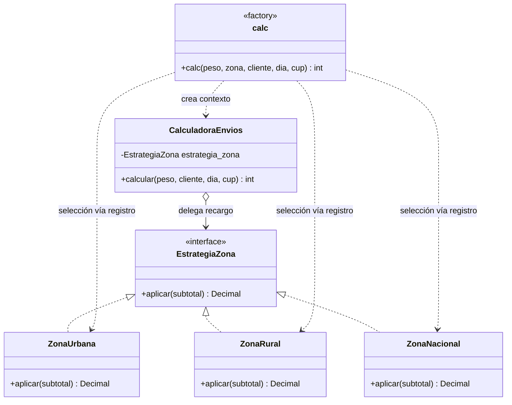

# Fase 5. Mantenimiento y refactorización — EnvíaYa

## 1. Alcance y conservación de la línea base

El código heredado permanece sin modificación en `envios.py`. Su contenido coincide con el blob original **`5585b110170a271dadc20c11d67f8c62fb9a0b3c`**, agregado históricamente en el commit `8fdc662` (`chore: registrar codigo heredado con parametros personalizados`). El diseño de pruebas de caja blanca P01–P15 continúa ejecutándose contra esa versión para conservar su caracterización.

La implementación activa refactorizada se encuentra en `src/calculadora.py`, con constantes en `src/configuracion.py` y estrategias concretas en `src/estrategias_zona.py`. Su función pública es `src.calculadora.calc(peso, zona, cliente, dia, cup=None)`; el argumento de impresión `flag` ya no existe en esta interfaz y el cálculo no imprime. Se conserva el archivo heredado como artefacto histórico; los consumidores de la nueva implementación deben importar desde `src.calculadora`.

## 2. Malos olores del código original

Las líneas se refieren a la versión original de 40 líneas de `envios.py` antes de refactorizar. Un code smell señala una estructura que dificulta el mantenimiento; no es por sí solo prueba de defecto funcional.

| Code smell y líneas | Fragmento | Problema y deuda técnica | Solución aplicada |
|---|---|---|---|
| **Long Method**, líneas 11–40 | `def calc(...):` concentra validación, tarifas, zona, calendario, descuentos, piso, impresión y redondeo. | Muchas razones de cambio en una función; aumenta el costo de aislar y explicar reglas. | Extracción a `validar_peso`, `validar_dia`, `calcular_tarifa_base`, `aplicar_descuento_cliente`, `aplicar_cupon`, `aplicar_costo_minimo` y `redondear_a_centena`; coordinación en `CalculadoraEnvios.calcular`. |
| **Magic Numbers**, líneas 3–8, 15–19, 28, 30, 35 y 37 | `3`, `10`, `6000`, `9000`, `800`, porcentajes y `5000` aparecen en expresiones y asignaciones. | El significado de cada literal depende del contexto; cambios personalizados pueden quedar incompletos. | Constantes de dominio con nombres en `src/configuracion.py`, todas con valores personalizados y decimales explícitos. |
| **Flag Argument**, línea 11 y ramas 38–39 | `flag=False` elige si la función también imprime. | Un parámetro cambia el efecto externo de una operación de cálculo y obliga a los llamadores a conocer un modo secundario. | Se eliminó `flag` de la API activa; `calc` solo devuelve el costo. El código legado conserva el argumento porque no se altera. |
| **Side effect in calculation**, líneas 38–39 | `print("costo:", t)` dentro de `calc`. | La salida de consola mezcla presentación con cálculo y dificulta reutilizar la función. | No se imprime desde la calculadora activa; cualquier presentación corresponde a una capa llamadora. |
| **Conditional Complexity / Type Code**, líneas 20–25 | Cadena de comparaciones de `z` para urbana, rural y nacional. | Añadir una zona exige editar el cuerpo central; una zona no reconocida cae silenciosamente por el encadenamiento. | Interfaz `EstrategiaZona`, clases `ZonaUrbana`, `ZonaRural`, `ZonaNacional` y registro explícito que rechaza claves desconocidas. |
| **Dead Store / Self Assignment**, línea 21 | `t = t` en la rama urbana. | La asignación no cambia el valor ni aporta información; oculta que la rama no aplica ninguna operación. | `ZonaUrbana.aplicar` devuelve el subtotal sin mutarlo; desaparece la asignación redundante. |
| **Primitive Obsession / stringly typed dispatch**, firma línea 11 y comparaciones líneas 20–35 | Zona, cliente y cupón se expresan con cadenas literales dispersas. | Errores tipográficos y valores desconocidos no se distinguen siempre; los condicionales y textos deben mantenerse sincronizados. | Estrategias y mapa de zonas; constantes para cupones/descuentos; la zona inválida se rechaza. No se impuso validación de cliente desconocido porque el enunciado no define ese comportamiento. |
| **Comparación no idiomática con None**, línea 33 | `cup != None`. | Estilo menos claro que una comprobación de identidad y condición anidada innecesaria para reconocer un único cupón. | La función activa compara directamente con `CODIGO_CUPON`; cualquier otro valor se ignora según R7. |

### Smells frente a defectos funcionales

Los smells anteriores son observaciones de diseño. Los defectos funcionales confirmados en la Fase 4 fueron DEF-01 a DEF-04. Las condiciones de peso, zona/día, sábado y redondeo incumplían R1–R8; la asignación redundante, el flag y la longitud del método eran smells aunque no constituyeran por sí solos incumplimientos de tarifa.

## 3. Clasificación del mantenimiento

| Tipo | Cambios de esta fase | Justificación |
|---|---|---|
| **Correctivo** | Correcciones DEF-01–DEF-04: tramo de 3 kg, validación de zona y día, sábado y redondeo. | Reparan diferencias reproducidas entre los resultados del legado y los requisitos R1–R8. |
| **Adaptativo** | La interfaz activa se trasladó a `src.calculadora.calc` y dejó de aceptar `flag`; las pruebas funcionales ahora importan esa implementación. | Adapta el punto de entrada al contrato de cálculo sin efecto de consola. Es un cambio de interfaz para usuarios del nuevo módulo; el legado queda conservado para lectura y comparación. |
| **Perfectivo** | Extracción de funciones, constantes semánticas, cálculos con `Decimal`, patrón Estrategia para zonas y separación entre contexto y selección de estrategia. | Mejora claridad, modularidad, exactitud decimal y facilidad para explicar o extender reglas. |
| **Preventivo** | Validaciones explícitas, estrategia de zona tipada, pruebas de entradas no finitas/no numéricas y pruebas de regresión completas. | Reduce el riesgo de aceptar entradas inválidas o reintroducir los defectos al modificar reglas futuras. |

No se implementó la zona insular ni se modificaron los parámetros personalizados. La estructura de estrategias permite añadir otras zonas en la fase de cambio sin introducirlas antes de tiempo.

## 4. Arquitectura refactorizada

### 4.1 Responsabilidades

- `src/configuracion.py`: límites y montos personalizados como constantes `Decimal`.
- `src/estrategias_zona.py`: interfaz `EstrategiaZona`, estrategias concretas y resolución validada de zona.
- `src/calculadora.py`: validaciones y funciones pequeñas para tarifa base, descuentos, cupón, costo mínimo y redondeo. `CalculadoraEnvios` ordena los pasos de una cotización.
- `envios.py`: versión heredada, preservada exactamente para auditoría histórica.

El orden activo del cálculo es: validar peso y día → resolver zona → tarifa base → estrategia zonal → recargo de día 6/7 → descuento del cliente → cupón → piso de $5.000 → redondeo al múltiplo de $100.

### 4.2 Patrón Estrategia

El patrón está implementado en código:

1. `EstrategiaZona` define el contrato `aplicar(subtotal)`.
2. `ZonaUrbana`, `ZonaRural` y `ZonaNacional` proporcionan comportamientos concretos.
3. `obtener_estrategia_zona` selecciona la instancia correspondiente y rechaza una zona desconocida.
4. La función `calc` crea `CalculadoraEnvios` (el contexto) con esa estrategia.
5. `CalculadoraEnvios.calcular` aplica `self._estrategia_zona.aplicar(subtotal)` sin conocer la fórmula particular.

Así, las reglas zonales están encapsuladas y la calculadora mantiene un flujo común. Añadir otra zona implica una estrategia concreta y su registro; no exige insertar otra rama de cálculo central.



## 5. Defectos corregidos y vínculo con pruebas

| Defecto | Corrección en implementación activa | Casos Fase 4 que fallaban y ahora pasan |
|---|---|---|
| DEF-01 — p=3 en tramo inferior | Primer tramo usa `peso < LIMITE_TRAMO_1`; desde 3 kg usa segundo tramo. | BB-04, BB-13–BB-14, BB-16–BB-18, BB-21–BB-39 |
| DEF-02 — zona/día inválidos aceptados | Resolución de zona y `validar_dia` lanzan `ValueError` ante entradas inválidas. | BB-12, BB-15, BB-19, BB-20 |
| DEF-03 — sábado no recargado | Membresía en `DIAS_FIN_SEMANA = {6, 7}`; el recargo precede a descuentos. | BB-21, BB-25–BB-27, BB-31–BB-33, BB-37–BB-39 |
| DEF-04 — truncamiento | `Decimal.quantize(..., ROUND_HALF_UP)` redondea al múltiplo de $100 con empate hacia arriba. | BB-09, BB-40 |

No se cambió ningún resultado esperado BB. Los casos de pesos menores que 3, PMAX, tarifa proporcional, tres zonas, cupón desconocido, descuentos secuenciales y mínimo también se ejecutaron como parte de la suite completa.

## 6. Resultados reales después del cambio

Ejecución final: [GitHub Actions, run 43109179938](https://github.com/Male0523/Parcial_IS/actions/runs/43109179938), en la rama `refactor/estrategia`, commit `857388d`.

- Python 3.12.16; pytest y pytest-cov instalados desde `requirements.txt`.
- **63 pruebas aprobadas, 0 fallidas, 0 errores**, en 0,16 s.
- Los 41 casos funcionales BB-01–BB-41 pasaron contra `src.calculadora.calc`.
- Los 15 casos estructurales P01–P15 pasaron contra `envios.py` heredado.
- Se aprobaron 7 comprobaciones adicionales de peso no numérico/no finito, día booleano y zona de tipo no admitido.
- El job de Actions finalizó correctamente.

### Cobertura nueva

| Archivo | Sentencias | Sin cubrir | Ramas | Parciales | Cobertura |
|---|---:|---:|---:|---:|---:|
| `src/calculadora.py` | 61 | 0 | 20 | 0 | 100 % |
| `src/configuracion.py` | 19 | 0 | 0 | 0 | 100 % |
| `src/estrategias_zona.py` | 19 | 0 | 0 | 0 | 100 % |
| **Total** | **99** | **0** | **20** | **0** | **100 %** |

La cobertura de Fase 4 fue 29 sentencias y 26 ramas, 100 % sobre `envios.py` heredado. La cobertura posterior es 99 sentencias y 20 ramas, 100 % sobre los módulos activos `src/`. Los porcentajes coinciden, pero los objetos medidos son distintos: la suite antigua medía el legado; la suite nueva mide la implementación modular.

## 7. Comparación de complejidad, líneas y mantenibilidad

### Complejidad ciclomática

Se usa la misma interpretación de McCabe que en `docs/04_caja_blanca.md`: V(G)=E−N+2P, con un nodo de salida común y predicados de cortocircuito representados. Para comparar un cuerpo con funciones extraídas, se reportan tanto el punto de entrada como la función nueva más compleja.

- **Original:** `calc` monolítica = **15**.
- **Refactorizado:** punto de entrada `calc` = **1**; método de contexto `CalculadoraEnvios.calcular` = **2**; función más compleja `validar_peso` = **5**.
- La suma por bloques de todas las funciones y estrategias nuevas es **27** (base 1 por bloque, decisiones condicionales y manejadores de excepción). Esa suma aumenta porque el comportamiento se dividió en más unidades; el riesgo por unidad cae: máximo 15 → 5. No se presenta la suma agregada como una reducción.
- Las decisiones están repartidas entre validación (peso/día), tarifa, cupón, costo mínimo y día de fin de semana; la selección de zona usa el registro de estrategias.

### Líneas físicas

Conteo con `wc -l`, incluyendo líneas vacías y docstrings:

| Base medida | Líneas |
|---|---:|
| Legado `envios.py` | 40 |
| Implementación activa `src/\*.py` | 208 |

La nueva implementación tiene más líneas físicas porque añade módulos, nombres de dominio, tipos, docstrings, estrategias y funciones separadas. La longitud por sí sola no mide mantenibilidad; la comparación de complejidad por función y la cobertura complementan el conteo.

### Mantenibilidad

- La lógica tarifaria se puede localizar por función y las tasas se definen una sola vez.
- Las zonas se agregan mediante la interfaz de estrategia.
- La validación rechaza errores antes del cálculo.
- `Decimal` elimina dependencia de aproximaciones binarias en importes y porcentajes.
- El cálculo no escribe en consola ni ofrece modos mediante un flag.
- La suite reproduce criterios de aceptación y caminos históricos; ahora los funcionales protegen la implementación activa.

Estas son propiedades de diseño observables; no se asignó una puntuación automatizada de mantenibilidad.

## 8. Evidencia reproducible

El artefacto `enviaya-test-evidence-43109179938` contiene el log real, JUnit XML, JSON de cobertura, código de salida y resumen. Está disponible desde la página del [run 43109179938](https://github.com/Male0523/Parcial_IS/actions/runs/43109179938) hasta el 9 de febrero de 2027.

Desde la raíz del repositorio en Codespaces:

```bash
git switch refactor/estrategia
python -m pip install -r requirements.txt
python -m pytest -q tests/ --junitxml=evidencias/junit.xml --cov=src --cov-branch --cov-report=term-missing --cov-report=json:evidencias/coverage.json
```

## 9. Control de cambios

- `envios.py` conserva su SHA de contenido original: `5585b110170a271dadc20c11d67f8c62fb9a0b3c`.
- Los resultados Fase 4 en `docs/05_resultados_pruebas.md` se preservan como línea base histórica.
- No se implementó la zona insular.
- La rama de esta fase es `refactor/estrategia`; no se trabajó sobre `main`.
