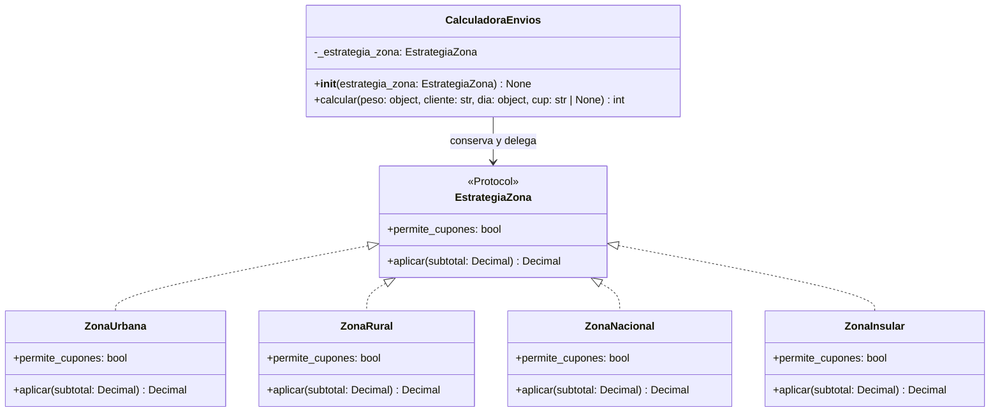

# Informe final del proyecto EnvíaYa

## Portada

**Proyecto:** EnvíaYa - Sistema de cálculo de costos de envío  
**Asignatura:** Ingeniería de Software I  
**Repositorio:** [Male0523/Parcial_IS](https://github.com/Male0523/Parcial_IS)  
**Rama integrada:** main  
**Commit consolidado de Fase 7:** 2db2f81d56d95930c5f35f9f63981ee4cc17c52c

| Campo académico | Información |
|---|---|
| Estudiante | Maria Alejandra Sanchez Magdaniel |
| Código registrado en los requisitos | 0182410122 |
| Docente | Robert Quintero |
| Institución | Universidad de la Guajira |
| Fecha de entrega | 11/11/2026 |

**Derivación de los parámetros:** el código estudiantil es 0182410122; sus últimos seis dígitos son 410122 y se asignan en orden a A–F.

| Dígito | Valor |
|---|---:|
| A | 4 |
| B | 1 |
| C | 0 |
| D | 1 |
| E | 2 |
| F | 2 |

## 1. Introducción

Este informe consolida el proceso de ingeniería realizado para EnvíaYa: especificación de requisitos, diseño de pruebas, automatización, evaluación del código heredado, refactorización, control de versiones e incorporación de la zona insular de San Andrés.

El trabajo separa dos implementaciones con propósitos distintos. El archivo histórico envios.py conserva el código original para permitir su auditoría y caracterizar sus caminos de control. La implementación activa se organiza en src/ y recibe las correcciones y la nueva estrategia insular. Los resultados de pruebas se reportan por fase, sin mezclar la línea base heredada con las ejecuciones de la solución refactorizada.

## 2. Objetivos

### Objetivo general

Documentar y verificar el ciclo de vida de EnvíaYa desde los requisitos personalizados hasta una implementación modular probada, manteniendo trazabilidad entre especificación, diseño, código, pruebas e historial de Git.

### Objetivos específicos

- Formalizar R1-R8 y las reglas derivadas de los parámetros estudiantiles.
- Diseñar pruebas de caja negra y caja blanca antes de la automatización.
- Medir el comportamiento heredado frente a los resultados exigidos y registrar los defectos observados.
- Refactorizar la calculadora con responsabilidades separadas y el patrón Strategy.
- Incorporar la zona insular sin alterar las reglas de las zonas existentes ni el archivo heredado.
- Mantener evidencia real de pruebas y cobertura en GitHub Actions.
- Conservar historial, ramas, integraciones, etiquetas y notas de versión verificables.

## 3. Descripción y alcance

EnvíaYa calcula un costo de envío a partir del peso, la zona, el tipo de cliente, el día de la semana y, cuando está permitido, un cupón. La calculadora valida las entradas, establece una tarifa base, aplica recargos y descuentos en el orden especificado y normaliza el importe final.

La línea base original incluyó las zonas urbana, rural y nacional. La solicitud de cambio CAMBIO=0 incorporó posteriormente la zona insular de San Andrés en la implementación activa. La ampliación vive en src/; no modifica envios.py.

El alcance académico comprende requisitos funcionales, diseño y automatización de pruebas, refactorización, análisis de mantenibilidad, control de configuración y el cambio insular. No se documentan interfaces gráficas, persistencia, despliegue de producción ni reglas comerciales adicionales que no estén en el repositorio.

## 4. Parámetros personalizados

Los últimos seis dígitos del código estudiantil 0182410122 forman 410122 y se asignan en orden A=4, B=1, C=0, D=1, E=2 y F=2. De acuerdo con las fórmulas registradas en `docs/01_requisitos.md`, se derivan PMAX = 30 + 5A = 50 kg; L1 = 2 + (B mod 3) = 3 kg; L2 = 10 + C = 10 kg; RR = 10 + 5(E mod 4) = 20%; RN = 40 + 5(F mod 3) = 50%; V = 10 + 5(A mod 3) = 15%; S = 2000 + 500(C mod 4) = $2.000; y CAMBIO = (A + F) mod 3 = (4 + 2) mod 3 = 0, solicitud correspondiente a la zona insular de San Andrés.

| Parámetro | Fórmula o regla | Valor | Aplicación |
|---|---|---:|---|
| PMAX | 30 + 5A | 50 kg | Límite superior válido de peso |
| L1 | 2 + (B mod 3) | 3 kg | Umbral entre primer y segundo tramo |
| L2 | 10 + C | 10 kg | Límite superior del segundo tramo |
| RR | 10 + 5(E mod 4) | 20 % | Recargo rural |
| RN | 40 + 5(F mod 3) | 50 % | Recargo nacional |
| V | 10 + 5(A mod 3) | 15 % | Descuento VIP |
| S | 2000 + 500(C mod 4) | $2.000 | Recargo en días 6 y 7 |
| CAMBIO | (A + F) mod 3 | 0 | Incorporación de San Andrés, zona insular |

También se aplican descuento frecuente de 5%, cupón ENVIO10 de 10%, tarifa base de $6.000 y $9.000, $800 por kilogramo proporcional sobre 10 kg y costo mínimo de $5.000. Las reglas de paridad son: D=1 impar, el primer tramo exige peso menor que 3 kg; E=2 par, el recargo de fin de semana antecede a los descuentos; B=1 impar, primero se aplica el descuento de cliente y luego el cupón; F=2 par, los cupones desconocidos se ignoran en las zonas que los admiten.

## 5. Requisitos funcionales R1-R8

La línea base se encuentra en [docs/01_requisitos.md](01_requisitos.md). La solicitud de la zona insular se registra aparte; no se renumeraron los requisitos originales.

| Requisito | Regla consolidada |
|---|---|
| R1 - Peso | Se admite 0 < peso <= 50 kg, incluidos decimales. La infracción produce ValueError. |
| R2 - Zona y día | La línea base admite urbana, rural o nacional; el día debe ser entero de 1 a 7. Entradas fuera del dominio deben generar un error, sin que el requisito base fije una clase específica para zona o día. |
| R3 - Tarifa base | Menos de 3 kg: $6.000. Desde 3 hasta 10 kg inclusive: $9.000. Sobre 10 kg: $9.000 más $800 por kilogramo proporcional de exceso. |
| R4 - Zona | Urbana: 0 %. Rural: 20 %. Nacional: 50 %. La zona insular se agrega después mediante CAMBIO=0. |
| R5 - Fin de semana | Días 6 y 7 agregan $2.000 antes de descuentos. |
| R6 - Descuentos | Frecuente: 5 %. VIP: 15 %. ENVIO10: 10 %. Si coinciden cliente y cupón, primero se aplica cliente y luego cupón. |
| R7 - Cupón desconocido | Se ignora sin descuento ni error en las zonas que aceptan cupones. La solicitud insular establece una excepción por zona. |
| R8 - Mínimo y redondeo | El costo no baja de $5.000. Se redondea al múltiplo de $100 más cercano; los empates de $50 suben. |

La especificación no convierte el tipo de cliente desconocido en una validación obligatoria; esa ambigüedad permanece documentada en los requisitos.

## 6. Auditoría del código heredado

El artefacto heredado se agregó en el commit 8fdc6625efaffb39dcb70d57c9495503fc096306. El blob de envios.py en main conserva el SHA 5585b110170a271dadc20c11d67f8c62fb9a0b3c, igual al del contenido original. La función heredada calc(p, z, c, d, cup=None, flag=False) no fue modificada; las pruebas P01-P15 continúan apuntando a ella.

La Fase 4 confirmó cuatro defectos frente a R1-R8:

La severidad y prioridad siguientes son una evaluación técnica del equipo basada en impacto y extensión; no se atribuyen al profesor. Las observaciones corresponden al comportamiento legado en la Fase 4.

| Defecto | Evidencia histórica del legado | Req. | Severidad / prioridad técnica del equipo |
|---|---|---|---|
| DEF-01 - Límite de 3 kg asignado al tramo inferior | BB-04 esperaba $9.000 y observó $6.000; más casos de p=3 se listan en docs/05_resultados_pruebas.md. | R3 | Alta / P1 |
| DEF-02 - Zona y día inválidos aceptados | BB-12, BB-15, BB-19 y BB-20 esperaban error; el legado retornó un importe. | R2 | Media / P1 |
| DEF-03 - Sábado sin recargo | La condición `d > 6` excluía el día 6; la comparación BB-21 frente a domingo evidenció la diferencia. | R5 | Media / P2 |
| DEF-04 - Truncamiento monetario | BB-40 requería $9.100 desde $9.050 y observó $9.000; BB-09 requería $41.000 y observó $40.900. | R8 | Media / P1 |

En la Fase 4 se aprobaron 25/56 = **44,64 %** de los casos y fallaron 31/56 = **55,36 %**; no hubo errores técnicos de entorno o de test. Como medida descriptiva de la inspección estática, cuatro defectos identificados sobre 40 líneas físicas equivalen a 4/40 × 100 = **10 defectos identificados por cada 100 líneas físicas**. No es una tasa estadística ni un conteo de fallas de prueba: cada causa se cuenta una vez, aunque afecte muchos casos, y el denominador no pondera gravedad ni complejidad.

Estos hallazgos son distintos de los malos olores de diseño. El informe de Fase 5 identifica, entre otros, Long Method, Magic Numbers, argumento flag, efecto de consola dentro del cálculo, asignación redundante, condicionales de zona y comparación no idiomática con None.

## 7. Diseño de pruebas

### 7.1 Caja negra

La matriz de [docs/03_caja_negra.md](03_caja_negra.md) diseña 41 casos BB-01 a BB-41 mediante:

- Particiones de equivalencia para peso, zona, cliente, día y cupón, distinguiendo entradas válidas e inválidas sin inventar restricciones no especificadas.
- Análisis de valores límite en peso: 0, inmediatamente sobre 0, a ambos lados de 3, exactamente 3, a ambos lados de 10, exactamente 10, debajo y en PMAX, y sobre PMAX. También considera los días 0, 1, 7 y 8.
- Tabla de decisión para cliente normal, frecuente y VIP; cupón ausente, desconocido o ENVIO10; día laboral o de fin de semana. Son 3 x 3 x 2, es decir 18 combinaciones. El fin de semana se suma antes de descuentos y el descuento de cliente precede al cupón.

Los resultados esperados de caja negra representan requisitos; la documentación separa esos resultados del comportamiento legado deducido u observado.

### 7.2 Caja blanca

[docs/04_caja_blanca.md](04_caja_blanca.md) contiene el grafo Mermaid, 30 nodos, 43 aristas, un componente conectado y 14 nodos predicado para calc heredada. La complejidad ciclomática es 15 por los tres métodos:

- Aristas, nodos y componentes: V(G) = 43 - 30 + 2(1) = 15.
- Predicados: 14 + 1 = 15.
- Regiones: 15.

Se documentan 15 caminos independientes P01-P15 y sus entradas. P01 usa costera solo para recorrer estructuralmente el camino del legado; costera es inválida según R2 y no es un caso funcional aceptado.

## 8. Automatización y resultados por etapa

La estructura automatizada está en tests/:

- test_caja_negra.py: 41 casos funcionales BB contra la calculadora activa tras la refactorización.
- test_caja_blanca.py: 15 caminos P contra envios.py heredado.
- test_regresion.py: siete comprobaciones defensivas adicionales.
- test_zona_insular.py: 18 ejecuciones parametrizadas: INS-01–INS-12 de la aceptación original y INS-13–INS-18 para recargos rural, nacional e insular con pesos mayores de 10 kg, hasta 50 kg, en días laborales y fines de semana.

El workflow .github/workflows/tests.yml instala pytest y pytest-cov, ejecuta la suite y conserva JUnit XML, salida de pytest, JSON de cobertura y resumen como artefactos. Las cifras siguientes corresponden a etapas y objetos medidos distintos:

| Etapa y evidencia | Resultado de pruebas | Cobertura reportada |
|---|---|---|
| Fase 4, run 43107058958, código heredado | 56 ejecutadas: 25 aprobadas, 31 fallidas y 0 errores técnicos. Las fallas fueron discrepancias funcionales respecto de los requisitos. | envios.py: 29/29 sentencias y 26/26 ramas, 100 %. |
| Fase 5, run 43109179938, rama refactor/estrategia | 63 aprobadas, 0 fallidas y 0 errores. | src/: 99/99 sentencias y 20/20 ramas, 100 %. |
| Fase 7 RED, run 43114555953, antes de implementar zona insular | 75 ejecutadas: 64 aprobadas y 11 fallidas esperadas por zona aún no soportada. | src/: 99/99 sentencias y 20/20 ramas, 100 %. |
| Fase 7 GREEN, run 43114870307 | 75 aprobadas, 0 fallidas y 0 errores. | src/: 110/110 sentencias y 22/22 ramas, 100 %. |
| Repetición documental, run 43115183647 | 75 aprobadas, 0 fallidas y 0 errores. | src/: 110/110 sentencias y 22/22 ramas, 100 %. |
| Corrección final PR #7, run 43133563143, commit 08dcbd9b2d81de87e86202e27a11447a67d4f563 | 81 aprobadas en cada uno de los cuatro comandos del workflow; 0 fallidas y 0 errores. | src/: 110/110 sentencias y 22/22 ramas, 100 %. |

Los runs RED y GREEN de Fase 7 ocurrieron en feature/zona-insular antes de su PR de integración. El PR #3 integró el cambio en main. La repetición documental fue una ejecución de Actions, no local. En la rama correctiva, el run [43133563143](https://github.com/Male0523/Parcial_IS/actions/runs/43133563143), sobre el commit de pruebas `08dcbd9b2d81de87e86202e27a11447a67d4f563`, ejecutó 81 pruebas aprobadas en cada uno de los cuatro comandos del workflow. La salida JUnit fue generada el `2026-11-12T01:18:21.704410+00:00` (marca temporal registrada en el XML) y muestra 81 pruebas, 0 fallidas, 0 errores y 0 omitidas. `coverage.json` del mismo artefacto reporta 110/110 sentencias y 22/22 ramas (100 %), sin sentencias ni ramas faltantes. Los archivos originales se extrajeron del artefacto `enviaya-test-evidence-43133563143` (ID `13906411633`) y se incorporaron sin reconstruirlos; ambos están presentes en el commit [54825710d5f93368e999d12518815deb4e6dc99f](https://github.com/Male0523/Parcial_IS/commit/54825710d5f93368e999d12518815deb4e6dc99f). Este run verifica el código de pruebas de esa rama, no el HEAD de `main`.

## 9. Refactorización y arquitectura

La implementación activa separa configuración y responsabilidades:

- src/configuracion.py define constantes con Decimal.
- src/estrategias_zona.py contiene el protocolo EstrategiaZona, las estrategias urbana, rural, nacional e insular, y el registro de selección.
- src/calculadora.py valida peso y día, calcula tarifas, coordina el contexto CalculadoraEnvios, aplica la política de cupón y delega recargos por zona.
- tests/ protege la conducta funcional activa y conserva la caracterización de envios.py.

El patrón Strategy evita mantener la fórmula de recargo de cada zona en un único condicional. La estrategia concreta modifica el subtotal; el contexto conserva orden común para fin de semana, descuentos, costo mínimo y redondeo. `calc` obtiene la estrategia mediante `obtener_estrategia_zona` y la entrega al contexto `CalculadoraEnvios`.

La comparación cuantitativa documentada en Fase 5 usa la medición de esa fase, anterior a la estrategia insular:

| Métrica | Heredado | Refactorización medida en Fase 5 |
|---|---:|---:|
| Complejidad de calc | 15 | 1 |
| Complejidad del método de contexto | No existía | 2 |
| Mayor complejidad de función individual | calc: 15 | validar_peso: 5 |
| Líneas físicas en la medición documentada | envios.py: 40 | src/*.py: 208 |
| Cobertura | envios.py: 29 sentencias, 26 ramas | src/: 99 sentencias, 20 ramas |

La suma de complejidad por bloques nuevos fue 27; no se presenta como una reducción, ya que las responsabilidades extraídas crean más funciones. La cobertura posterior a Fase 7 es distinta: src/ mide 110 sentencias y 22 ramas. La mayor extensión de líneas refleja separación, documentación y estrategia, no un aumento comparable de complejidad por función.

## 10. Gestión de configuración

Al preparar esta corrección, la rama `main` estaba en el commit **9967f0d4f1c9c39d380f611f65dfaf9580a66b57** (`test: agregar evidencias de cobertura y resultados`). La rama de esta propuesta es `docs/final-quality-corrections`, creada desde ese HEAD. El PR [#7](https://github.com/Male0523/Parcial_IS/pull/7) está abierto como borrador y no se ha fusionado.

| PR | Estado comprobado | Hito | Merge commit |
|---|---|---|---|
| [#1](https://github.com/Male0523/Parcial_IS/pull/1) | Fusionado | Suite BB y P | 24dd66794b604dfb938a6fba0759f14c1d74a1de |
| [#2](https://github.com/Male0523/Parcial_IS/pull/2) | Fusionado | Refactorización y estrategia | af258871346022904ebdf8fac7bfb629464bcea3 |
| [#3](https://github.com/Male0523/Parcial_IS/pull/3) | Fusionado | Zona insular | 2db2f81d56d95930c5f35f9f63981ee4cc17c52c |
| [#4](https://github.com/Male0523/Parcial_IS/pull/4) | Fusionado | Informe final inicial | d24a703e5a571ea9646e30cf538897122cabd5e6 |
| [#5](https://github.com/Male0523/Parcial_IS/pull/5) | Fusionado | Ajustes académicos | c892adcc64691c5f58492de67a412225c1d3e295 |
| [#6](https://github.com/Male0523/Parcial_IS/pull/6) | Fusionado | Configuración y mantenibilidad | c9114b52c3fb61d6922828a7096dee01d14d499c |
| [#7](https://github.com/Male0523/Parcial_IS/pull/7) | Abierto, borrador | Correcciones de calidad de esta propuesta | Pendiente |

Las etiquetas Git verificadas apuntan a los hitos históricos, no al HEAD actual: `v1.0.0` → `8fdc6625efaffb39dcb70d57c9495503fc096306`; `v1.1.0` → `af258871346022904ebdf8fac7bfb629464bcea3`; `v1.2.0` → `2db2f81d56d95930c5f35f9f63981ee4cc17c52c`. CHANGELOG y notas por versión están en la raíz y en `docs/releases/`.

`evidencias/historial_git.txt` contiene un extracto actualizado de esta rama hasta el commit padre de su actualización; no es el log completo de todas las refs. El PR #7 agrega documentación y pruebas, sin cambiar el código de producción ni `envios.py`.

## 11. Incorporación de la zona insular

CAMBIO=0 solicita la zona insular de San Andrés con recargo de 70 %. La estrategia se incorporó en src/estrategias_zona.py y se selecciona como insular. El cambio conserva validaciones globales de peso y día, recargo de fin de semana antes de descuentos, descuentos frecuente y VIP, mínimo y redondeo.

En zona insular, None y la cadena vacía se tratan como ausencia de cupón. Cualquier cupón proporcionado, conocido o desconocido, se rechaza. En las demás zonas se mantiene R7/F=2 y los códigos desconocidos se ignoran.

El enunciado no prescribe tipo de excepción ni mensaje para el cupón prohibido. Se eligió ValueError con el mensaje documentado en Fase 7; es una decisión técnica coherente con la validación de entradas, no una exigencia textual. La solicitud es aditiva y se registra como v1.2.0.

La evidencia TDD es RED en run 43114555953 y GREEN en run 43114870307, seguida por run 43115183647 tras actualizar documentación. El informe del cambio contiene casos, resultados, decisiones y enlaces a los artefactos.

## 12. Conclusiones

La trazabilidad se conserva desde las reglas personalizadas y las historias HU-01 a HU-03 hasta los casos de caja negra, caminos de caja blanca, funciones y evidencia de Actions. La evaluación heredada hizo visibles cuatro defectos sin alterar el artefacto histórico. La refactorización separó validación, cálculo y estrategia; la zona insular se añadió como una estrategia compatible con el flujo existente.

La evidencia de cobertura al 100 % se presenta siempre asociada a su fase y objeto medido. En particular, el 100 % sobre envios.py de Fase 4 no significa que las reglas fueran funcionalmente correctas: la suite heredada tuvo 31 fallas legítimas frente a requisitos. Las 75 pruebas aprobadas y la cobertura 110/110 sentencias y 22/22 ramas pertenecen a las ejecuciones GREEN de Fase 7. La ejecución correctiva en la rama del PR #7 aprobó 81 pruebas y obtuvo 110/110 sentencias y 22/22 ramas. Las ejecuciones citadas son de GitHub Actions y se asocian a sus ramas y commits; no se atribuye ejecución local.

## 13. Matriz de trazabilidad

Los resultados de Fase 4 documentan el legado (diferencias esperadas frente a los requisitos). Las evidencias de Fases 5 y 7 verifican la implementación activa corregida en `src/`. P01–P15 caracterizan exclusivamente el flujo heredado; en particular, P01 usa una zona inválida solo para recorrido estructural. La prueba insular INS-12 valida que las demás zonas continúan ignorando cupones desconocidos.

| Requisito / historia | Definición | Casos de caja negra BB | Caminos heredados P | Casos insulares INS | Implementación relacionada | Evidencia histórica del legado (Fase 4) | Evidencia de comportamiento corregido |
|---|---|---|---|---|---|---|---|
| R1 — HU-01, HU-03: límites y validación de peso | docs/01_requisitos.md | BB-01, BB-02, BB-10, BB-11 | P02–P04 | INS-10 | `src/calculadora.py:validar_peso` | BB-01, BB-02, BB-10 y BB-11 aprobados en el legado; no evidencian defecto de R1. | Suite Fase 7: 75 aprobadas (run 43115183647); suite correctiva completa: 81 aprobadas (run 43133563143). |
| R2 — HU-03: zona y día válidos | docs/01_requisitos.md | BB-12–BB-15, BB-19–BB-20 | P01 solo recorre estructuralmente la caída de comparaciones de zona; no es aceptación funcional ni valida día. | INS-10–INS-11 | `src/calculadora.py:validar_dia, calc`; `src/estrategias_zona.py:obtener_estrategia_zona` | DEF-02: BB-12, BB-15, BB-19 y BB-20 fallaron al devolver importes en vez de error. | Pruebas BB/INS de entradas inválidas; suite Fase 7: run 43115183647; ejecución correctiva completa: 81 aprobadas, run 43133563143. |
| R3 — HU-01: tramos y exceso proporcional | docs/01_requisitos.md | BB-02–BB-10, BB-13–BB-18, BB-21–BB-40 | P04–P05 (peso menor o igual a L1; y L1 < peso ≤ L2). P06 es zona urbana, no tarifa base. | INS-01, INS-06–INS-09 | `src/calculadora.py:calcular_tarifa_base` | DEF-01: BB-04 esperaba $9.000 y observó $6.000 a 3 kg; múltiples casos relacionados fallaron por la misma condición heredada. | Suites Fase 5 y Fase 7, runs 43109179938 y 43115183647, aprobadas. |
| R4 — HU-01: recargo por zona | docs/01_requisitos.md; docs/08_cambio_insular.md | BB-16–BB-18 | P06–P08 (urbana, rural, nacional) | INS-01, INS-06–INS-09 | `src/estrategias_zona.py:ZonaUrbana, ZonaRural, ZonaNacional, ZonaInsular`; `src/configuracion.py` | BB-16–BB-18 aparecen fallidas con p=3 por DEF-01; no prueban un defecto separado de recargo zonal. | Fase 7 GREEN y repetición (runs 43114870307 y 43115183647); además, run 43133563143 aprobó los casos INS-13–INS-18 de recargo zonal. |
| R5 — HU-02: recargo de fin de semana | docs/01_requisitos.md | BB-14, BB-21, BB-25–BB-27, BB-31–BB-33, BB-37–BB-39 | P09 | INS-08–INS-09 | `src/calculadora.py:CalculadoraEnvios.calcular` | DEF-03: BB-21 (sábado) y su comparación con domingo revelan omisión; importes a 3 kg también reflejan DEF-01. | Fase 5/Fase 7 GREEN, runs 43109179938 y 43115183647; INS-13–INS-18 y run 43133563143 verifican recargos por zona a pesos >10 kg. |
| R6 — HU-02: descuentos y orden secuencial | docs/01_requisitos.md | BB-22–BB-39 | P10–P13 | INS-06–INS-09 | `src/calculadora.py:aplicar_descuento_cliente, aplicar_cupon, CalculadoraEnvios.calcular` | Varios BB con p=3 fallan por DEF-01 y algunos por DEF-03/DEF-04; no se documenta un defecto de fórmula de descuento independiente. | Fase 5/Fase 7 GREEN, runs 43109179938 y 43115183647; INS-13–INS-18 también verifican descuentos y orden junto con el recargo zonal. |
| R7 — HU-02: cupón desconocido ignorado | docs/01_requisitos.md; excepción insular en docs/08_cambio_insular.md | BB-23, BB-26, BB-29, BB-32, BB-35, BB-38 | P01 (código desconocido con zona estructuralmente inválida), P06 (cupón ausente), P12 (cupón desconocido en zona válida) y P13 (ENVIO10) | INS-02–INS-05 (insular rechaza cupones); INS-12 (urbana ignora desconocido) | `src/calculadora.py:aplicar_cupon, CalculadoraEnvios.calcular`; `src/estrategias_zona.py:permite_cupones` | Los BB con peso 3 que fallaron no aíslan R7; P01 es caracterización del legado, no una entrada de negocio válida. | INS-12 pasó en RED y suite GREEN (runs 43114555953 y 43115183647); INS-13–INS-18 pasaron en 43133563143. |
| R8 — HU-03: mínimo y redondeo | docs/01_requisitos.md | BB-08–BB-10, BB-28, BB-30–BB-41 | P14 (costo mínimo) y P15 (flag y retorno legado) | El costo mínimo usa la ruta compartida; INS no reduce los importes válidos actuales por debajo del piso. | `src/calculadora.py:aplicar_costo_minimo, redondear_a_centena` | DEF-04: BB-09 y BB-40 fallaron por truncamiento; BB-41 comprobó el piso. | Fase 5/Fase 7 GREEN, runs 43109179938 y 43115183647; los seis casos INS-13–INS-18 pasaron en el run correctivo 43133563143. |
| Cambio CAMBIO=0 — nueva zona insular | docs/01_requisitos.md; docs/08_cambio_insular.md | Regresión de zonas existentes: BB-01–BB-41 | P01–P15 continúan siendo exclusivos de `envios.py`; no validan la estrategia insular. | INS-01–INS-11; INS-12 verifica paridad R7 en urbana; INS-13–INS-18 comprueban recargos zonales con pesos >10 y 50 kg | `src/configuracion.py:RECARGO_INSULAR`; `src/estrategias_zona.py:ZonaInsular`; `src/calculadora.py:CalculadoraEnvios.calcular` | No aplica a la línea base Fase 4: el cambio insular aún no existía. | RED: run 43114555953, 64 aprobadas/11 fallidas esperadas. GREEN: runs 43114870307 y 43115183647, 75 aprobadas y cobertura de src/ 100%. |

## 14. Referencias internas y evidencias

- [Requisitos y criterios de aceptación](01_requisitos.md)
- [Plan de pruebas](02_plan_pruebas.md)
- [Diseño de caja negra](03_caja_negra.md)
- [Diseño de caja blanca](04_caja_blanca.md)
- [Resultados de pruebas de Fase 4 y anotación histórica posterior](05_resultados_pruebas.md)
- [Refactorización y comparación](06_refactorizacion.md)
- [Gestión de configuración](07_gestion_configuracion.md)
- [Cambio insular, TDD y resultados](08_cambio_insular.md)
- [Changelog](../CHANGELOG.md)
- Notas de versión: [1.0.0](releases/v1.0.0.md), [1.1.0](releases/v1.1.0.md), [1.2.0](releases/v1.2.0.md)
- GitHub Actions: [Fase 4, run 43107058958](https://github.com/Male0523/Parcial_IS/actions/runs/43107058958), [Fase 5, run 43109179938](https://github.com/Male0523/Parcial_IS/actions/runs/43109179938), [Fase 7 RED, run 43114555953](https://github.com/Male0523/Parcial_IS/actions/runs/43114555953), [Fase 7 GREEN, run 43114870307](https://github.com/Male0523/Parcial_IS/actions/runs/43114870307), [repetición documental, run 43115183647](https://github.com/Male0523/Parcial_IS/actions/runs/43115183647), [corrección final, run 43133563143](https://github.com/Male0523/Parcial_IS/actions/runs/43133563143).
- Integraciones: [PR #1](https://github.com/Male0523/Parcial_IS/pull/1), [PR #2](https://github.com/Male0523/Parcial_IS/pull/2), [PR #3](https://github.com/Male0523/Parcial_IS/pull/3) y [PR #4](https://github.com/Male0523/Parcial_IS/pull/4), [PR #5](https://github.com/Male0523/Parcial_IS/pull/5), [PR #6](https://github.com/Male0523/Parcial_IS/pull/6) y [PR #7](https://github.com/Male0523/Parcial_IS/pull/7).

**Nota de consistencia de evidencias (PR #7).** La ejecución actual de Actions es el run 43133563143 en el commit 08dcbd9b2d81de87e86202e27a11447a67d4f563. Los reportes `evidencias/coverage.json` y `evidencias/junit.xml` ahora corresponden al artefacto del run 43133563143 y están versionados en la rama correctiva. `evidencias/historial_git.txt` es un extracto de la rama, limitado al commit padre del cambio del propio archivo; no se presenta como la salida completa de `git log --all`. El PDF de esta entrega se regeneró desde este Markdown actualizado; consta de nueve páginas y se inspeccionó visualmente en su totalidad, incluida la portada, las tablas, la matriz y el diagrama UML.
